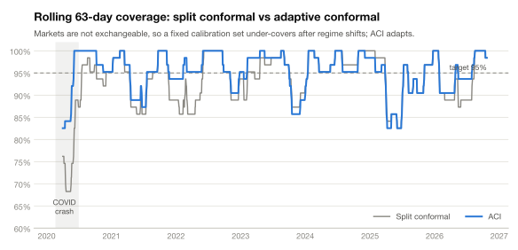

<p align="center">
  
</p>

<p align="center">
  <a href="https://github.com/priyanshu-mishra/aegis/actions/workflows/ci.yml"></a>
  
  
  
  <a href="LICENSE"></a>
</p>

**Aegis** wraps portfolio-risk forecasts in prediction intervals whose coverage is measured, not assumed. A semantic parser (a deterministic lexicon or a local small language model) turns financial text into structured shock signals; a factor engine forecasts volatility and Value-at-Risk; a conformal prediction layer calibrates the uncertainty around them. Everything is evaluated walk-forward on 2020–2026 market data, with tests that rule out look-ahead.

### Key findings

- **Textbook conformal prediction under-covers on real markets.** Split conformal reaches 93.3% instead of 95%, and 88.9% in 2020, because markets are not exchangeable. **Adaptive Conformal Inference (ACI) recovers 95.0%**, including 94.5% through the COVID year.
- **Conformal VaR fixes the 99% tail and keeps a bank's model in the green zone.** Gaussian (RiskMetrics) and historical-simulation VaR breach about twice as often as they should; conformal VaR breaches 0.82–0.99% of days against a 1% target and stays in the Basel green zone 94–99% of the time, against 56% for RiskMetrics. The trade-off is honest: being right costs more capital (22–31% vs 18%).
- **Text did not beat prices on real data, and the ablation shows why.** In a synthetic world with a known signal, text only helps when headlines are close to noise-free. Fixing the SLM's schema took its sign accuracy from 70% to 100%, but about eight FOMC statements a year is too sparse a signal.

---

## Contents

[Quickstart](#quickstart) · [How it works](#how-it-works) · [Results](#results) · [The text layer](#the-text-layer) · [Dashboard](#dashboard) · [Engineering](#engineering) · [Commands](#commands) · [Layout](#repository-layout)

## Quickstart

```bash
git clone https://github.com/priyanshu-mishra/aegis.git && cd aegis
```

```bash
python3 -m venv .venv && source .venv/bin/activate && pip install -e ".[dev,dashboard]"
```

```bash
python main.py demo
```

`demo` runs the whole pipeline offline on a synthetic market in about 3 seconds and writes a report to `reports/demo/`. Real data is one command away:

```bash
python main.py backtest -c configs/default.yaml
```

```bash
python main.py dashboard
```

## How it works

<p align="center">
  
</p>

**1 · Data.** Daily adjusted prices for an equal-weight SPY / TLT / GLD / USO portfolio plus the VIX, cached from yfinance. The text source is every FOMC statement since 2010, scraped from federalreserve.gov with its exact release time; emergency statements are included, such as the Sunday 15 March 2020 cut. A synthetic world, where hidden macro shocks drive returns, volatility regimes and headlines, provides ground truth for testing the text layer.

**2 · Semantic parser.** Text is masked (dates, years, named events and people are replaced so a model can't recall what came next) and parsed into a validated `RiskSignal`: six direction-named shocks (`rate_pressure`, `credit_stress`, …), sentiment, a volatility-premium signal and per-asset impacts. The Ollama backend forces the model's output to follow the JSON schema, validates it with pydantic, retries once, and falls back to the lexicon, so the pipeline never fails because the model did.

**3 · Factor engine.** An EWMA covariance (λ = 0.94) is rescaled by a semantic shock overlay `Σ̃ = D Σ D`, which keeps the covariance positive semi-definite and leaves correlations unchanged. A standardized ridge model with a cross-validated penalty predicts **target A**, the log realized portfolio volatility over the next 5 days, from HAR volatility terms (1, 5 and 22 days), EWMA volatility, the VIX and the text features. **Target B** is the next-day portfolio return, used for VaR.

**4 · Conformal layer.** On a held-out calibration set, compute non-conformity scores and take a finite-sample-corrected quantile:

$$S_i = \lvert y_i - \hat\mu(X_i) \rvert, \qquad \hat q = S_{(k)},\quad k = \lceil (n+1)(1-\alpha) \rceil, \qquad C(X) = [\hat\mu(X) - \hat q,\ \hat\mu(X) + \hat q]$$

If the data are exchangeable, this guarantees $1-\alpha \le P(y \in C(X)) \le 1-\alpha + \tfrac{1}{n+1}$. Market data are not exchangeable, so Aegis also runs a **rolling** window and **ACI**, which adjusts its working level after every realized outcome:

$$\alpha_{t+1} = \alpha_t + \gamma\,(\alpha - \mathrm{miss}_t), \qquad \Big\lvert \tfrac{1}{T}\textstyle\sum_t \mathrm{miss}_t - \alpha \Big\rvert \le \frac{\max(\alpha_1, 1-\alpha_1) + \gamma}{\gamma T}$$

ACI's bound holds for *any* sequence, with no distributional assumption. The same machinery with a one-sided score gives conformal VaR.

**5 · Walk-forward evaluation.** Train on 2010–2017, calibrate on 2018–2019, then score 2020–2026 one day at a time:

<p align="center">
  
</p>

## Results

All results below are out-of-sample: 1,712 trading days from January 2020 to October 2026, never used for fitting or calibration.

<picture>
  <source media="(prefers-color-scheme: dark)" srcset="docs/assets/intervals_2020-dark.svg">
  
</picture>

In March 2020, realized volatility jumped from about 7% to 76% annualized. Both methods missed the first days of the jump: no interval built from 2018–2019 data could contain it. The difference is what happened next. ACI registered the misses, lowered its working α and widened the band; split conformal kept the same fixed width it was calibrated with.

<picture>
  <source media="(prefers-color-scheme: dark)" srcset="docs/assets/rolling-dark.svg">
  
</picture>

<picture>
  <source media="(prefers-color-scheme: dark)" srcset="docs/assets/coverage-dark.svg">
  
</picture>

ACI is the only method that hits 95% overall *and* has the best worst quarter (82.5%). The uncalibrated Gaussian interval looks close overall (94.0%), but its coverage swings from 89.7% in 2020 to 98% in 2024: right on average, wrong in every regime.

<picture>
  <source media="(prefers-color-scheme: dark)" srcset="docs/assets/by_year-dark.svg">
  
</picture>

### Value-at-Risk

<picture>
  <source media="(prefers-color-scheme: dark)" srcset="docs/assets/var-dark.svg">
  
</picture>

| One-day VaR | 95%: breaches · Kupiec · Christoffersen | 99%: breaches · Kupiec · Christoffersen |
|---|---|---|
| Split conformal | 5.49% · pass · fail | 0.82% · pass · pass |
| Rolling conformal | 5.02% · pass · fail | 0.99% · pass · pass |
| ACI | 4.91% · pass · **pass** | 0.93% · pass · fail |
| Gaussian EWMA (RiskMetrics) | 4.96% · pass · fail | 1.93% · **fail** · pass |
| Historical simulation (250 days) | 5.78% · pass · fail | 1.69% · **fail** · fail |
| GARCH(1,1)-t | 5.72% · pass · fail | 1.40% · pass · fail |

The Kupiec test checks that the breach rate is right; the Christoffersen test checks that breaches don't cluster. At 95% every method gets the rate right and almost all fail on clustering, since breaches arrive in bursts during crises. At 99% the fat tails show: the Gaussian VaR breaches twice as often as it should. No single method passes everything. Rolling conformal is cleanest at 99%, and ACI is the only method without clustered breaches at 95%.

### The regulator's view: Expected Shortfall, 10-day VaR and the Basel traffic light

Banks don't stop at 1-day VaR. Basel III / FRTB measures market risk with **Expected Shortfall** at 97.5% (the average loss on the worst 2.5% of days), uses a **10-day** horizon, and grades VaR models with a **traffic light**: more than four 99% VaR exceptions in the last 250 days moves a model from the green zone to yellow, and raises the multiplier on its capital charge from 3.0 up to 4.0.

<picture>
  <source media="(prefers-color-scheme: dark)" srcset="docs/assets/basel-dark.svg">
  
</picture>

| Method | ES 97.5% backtest (Z2, zone) | 10-day 99% VaR breaches | Days in green zone | Max exceptions | Avg capital |
|---|---|---|---|---|---|
| Split conformal | -0.16 (green) | 0.58% (pass) | 98% | 5 | 21.8% |
| Rolling conformal | -0.02 (green) | 0.58% (pass) | 94% | 6 | 23.8% |
| **ACI** | +0.00 (green) | 0.58% (pass) | 99% | 5 | 30.6% |
| Gaussian EWMA (RiskMetrics) | -0.44 (green) | 1.17% (pass) | 56% | 9 | 18.0% |
| Historical simulation | -0.54 (green) | 3.51% (fail) | 66% | 12 | 18.7% |
| GARCH(1,1)-t | -0.26 (green) | 0.58% (pass) | 77% | 8 | 18.1% |

How to read this:
- **ES backtest (Acerbi–Székely Z2):** 0 means ES is right; negative means real tail losses were larger than forecast. Conformal ES comes out closest to 0. RiskMetrics and historical simulation underestimate the tail, though they stay inside the green threshold.
- **10-day breaches:** measured on non-overlapping windows, because overlapping 10-day windows would count one bad week several times.
- **Capital:** max(10-day VaR, multiplier × 60-day average), as a share of portfolio value.

Conformal methods spend 94–99% of days in the green zone, against 56% for RiskMetrics, but their more conservative VaR needs more capital even after the incumbent's yellow-zone penalty. That is the real trade-off a risk desk weighs.

**Where the risk comes from.** An Euler decomposition of the engine's covariance shows oil (USO) carrying on average **57% of the portfolio's risk with 25% of its weight**, peaking above 100% when Treasuries act as a hedge and take a negative share.

### What didn't work

Volatility-scaled (normalized) intervals and conformalized quantile regression (CQR) never beat the plain absolute residual (Winkler interval score 2.162, lower is better, vs 2.277 and 2.301). The target is log volatility, and taking the log already makes residuals about the same size in calm and stressed periods, so a scale model mostly adds noise. The online methods therefore default to the absolute score, which improved ACI from Winkler 2.320 to 2.212.

## The text layer

<picture>
  <source media="(prefers-color-scheme: dark)" srcset="docs/assets/ablation-dark.svg">
  
</picture>

The synthetic world answers a question real data can't: *if text contains a signal, does the pipeline find it?* Forecast error falls steadily as headlines get cleaner, from +1.9% with pure-noise headlines to −1.1% with near-noise-free ones, against a −2.2% ceiling when the model is given the true latent shocks. On real data, FOMC statements are too sparse to help, so `configs/default.yaml` runs price-only. Text features are clipped to their training range, so language from a new regime (pandemic, war, bank stress) can't drive unbounded extrapolation.

<picture>
  <source media="(prefers-color-scheme: dark)" srcset="docs/assets/slm-dark.svg">
  
</picture>

**A schema bug, not a model limitation.** The first schema used neutral factor names with a stated sign convention ("credit: positive = stress widening"). qwen2.5:3b reversed it wherever the convention was counter-intuitive, scoring "credit spreads tighten" as rising stress on every headline. Naming each field by its positive direction (`credit_stress`, `geopolitical_tension`) and adding balanced few-shot examples took sign agreement from 70% to 100%. The SLM now tracks the true shocks slightly better than the hand-written lexicon, with no hand-written rules. It still reads some zero-rate-era easing as tightening, including the March 2020 emergency cut.

## Dashboard

<p align="center">
  
</p>

`python main.py dashboard` opens a Streamlit app over every saved run. It shows:
- an interactive interval chart with misses marked
- coverage tables and rolling coverage by method
- VaR backtests with each test's pass/fail coloured
- the text ablation and latency results

## Engineering

**No look-ahead.**
- A news item counts toward day t only if it was published before that day's 4 p.m. New York close.
- Each segment ends with a 5-day embargo, so no training target overlaps calibration and no calibration target overlaps the test period.
- Online methods see a 5-day-ahead outcome only once it has happened.
- Inverse-vol weights for day t use data through day t−1.
- GARCH parameters are fitted on training data only, then frozen.
- An end-to-end test perturbs every price after a test day t and asserts that every interval and VaR level dated on or before t is unchanged.

**Statistical tests of the statistics.**
- Coverage is checked over 2,000 trials on deliberately misspecified models; it must fall within the finite-sample bound.
- ACI's long-run bound is checked exactly under a variance shift.
- The conformal quantile is property-tested (Hypothesis) against exact rational arithmetic.
- Kupiec and Christoffersen are checked against hand-calculated values, and the false-alarm rate is checked over 400 random breach sequences.
- ES formulas are checked by numerical integration and Monte Carlo, Z2 by simulation (≈ 0 for a correct model, negative when tails are fatter), and the Basel table and capital formula against hand calculations.

**Reliability.**
- The SLM's output is forced to follow the JSON schema and is validated, with a retry and a lexicon fallback.
- Parses are cached in SQLite by backend, model, prompt version and text, which also gives an audit log.
- Prices and FOMC statements are cached and downloaded incrementally.
- Configs are typed and validated: a misspelled key or an embargo shorter than the forecast horizon fails loudly.

**Latency (Apple M4 Pro, `python main.py bench`).**

| Measure | Value |
|---|---|
| Full backtest, 1,301 test days, all methods and baselines | 1.0 s |
| Score one day (point model + conformal interval), p50 / p95 | 0.39 / 0.56 ms |
| Lexicon parse per headline, p50 | 0.09 ms |
| SLM parse per headline (qwen2.5:3b via Ollama), p50 / p95 | 1.8 / 1.9 s |

**Guarantees and limits.** Split conformal's guarantee needs exchangeability, which market data violate; its test coverage here is an empirical result, not a guarantee. ACI's guarantee is long-run, not per quarter. Coverage within volatility regimes (conditional coverage) is reported but not guaranteed by any method here.

## Commands

| Command | What it does |
|---|---|
| `demo` | Offline end-to-end run on a synthetic market (no network, no model) |
| `fetch -c configs/default.yaml` | Download and cache prices and FOMC statements |
| `backtest -c <config>` | Walk-forward backtest → series, `metrics.json`, figures and a markdown report in `reports/<name>/` |
| `report -c <config>` | Re-render the report from saved series |
| `ablation -c <config>` | Compare runs with and without text (plus SNR sweep and oracle on synthetic data) |
| `parse -c <config>` | Parse the news store and print signal statistics |
| `bench` | Latency benchmark → `reports/benchmark.json` |
| `dashboard` | Streamlit app over all saved runs |
| `config -c <config>` | Print the resolved configuration |

Any setting can be overridden from the command line, e.g. `--set conformal.alpha=0.1`. There are three configs: `default` (real data, price-only), `synthetic` (known-signal world) and `ollama` (real data plus a local SLM).

<details>
<summary><b>Run the local SLM</b></summary>

```bash
brew install ollama
```

```bash
ollama serve &
```

```bash
ollama pull qwen2.5:3b
```

```bash
python main.py ablation -c configs/ollama.yaml
```

</details>

## Repository layout

<details>
<summary><b>Show the tree</b></summary>

```
main.py                    CLI entry (same as the `aegis` command)
configs/                   default · synthetic · ollama
src/aegis/
  config.py                typed, validated YAML config with --set overrides
  data/                    prices (yfinance + cache) · news store (as-of) · FOMC loader · synthetic world
  slm_parser.py            RiskSignal schema · masking · lexicon + Ollama backends · SQLite cache
  features.py              HAR / EWMA / VIX features · targets · as-of signal aggregation · clipping
  risk_engine.py           EWMA covariance · shock overlay · point / scale / quantile models
  conformal_ncm.py         non-conformity scores · split / rolling / ACI · walk-forward runner
  baselines.py             Gaussian, historical-simulation and GARCH VaR / ES, multi-day GARCH
  risk_measures.py         Expected Shortfall · Acerbi–Székely Z2 · Basel traffic light · capital · Euler
  metrics.py               coverage · Winkler · Kupiec · Christoffersen
  backtest.py              splits with embargo · walk-forward run for both targets
  report.py                metrics.json · figures · markdown report
  ablation.py · bench.py   text ablation · latency benchmark
dashboard/app.py           Streamlit dashboard over reports/*
scripts/                   make_readme_assets.py: regenerates every chart in this README
docs/                      PLAN.md (design + milestone log) · assets/ (diagrams and charts)
tests/                     152 offline tests + network and live-SLM tests
```

</details>

```bash
pytest
```

```bash
pytest -m "network or llm"
```

```bash
ruff check . && ruff format --check .
```

The default `pytest` run is fully offline. The `network` and `llm` markers add tests against yfinance, federalreserve.gov and a live Ollama model. Every chart in this README is regenerated from saved runs by `python scripts/make_readme_assets.py`.

## License

[MIT](LICENSE) © 2026 Priyanshu Mishra
