<p align="center">
  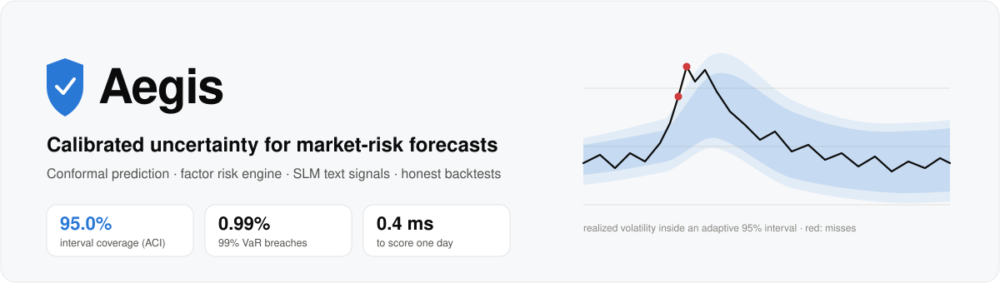
</p>

<p align="center">
  <a href="https://github.com/priyanshu-mishra/aegis/actions/workflows/ci.yml"></a>
  <a href="https://github.com/priyanshu-mishra/aegis/actions/workflows/site.yml"></a>
  
  
  <a href="LICENSE"></a>
</p>

<h3 align="center">A risk model that says how sure it is, and is checked on whether it was right.</h3>

<p align="center">
  <a href="https://priyanshu-mishra.github.io/aegis/"><b>Read the guided study</b></a>: a plain-language walk-through with live charts, refreshed every weeknight
  <br>
  <a href="docs/MODEL_CARD.md"><b>Model validation report</b></a>: the same evidence, written up the way a bank's model-risk team would review it
</p>

---

## In one minute

Every investment firm forecasts risk: *how much could this portfolio lose, and how bumpy will next week be?* Those forecasts set position sizes, loss limits and, at banks, the capital regulators require. But a forecast is only a single number, and markets are noisy. What matters just as much is **how wrong the forecast might be**, and whether the model is honest about it.

**Aegis** puts an error bar around every risk forecast, using a statistical method called *conformal prediction*, and then audits that error bar on 1,712 trading days the model never saw (January 2020 to October 2026, crash included). The error bar comes with a promise ("the true value will fall inside this range 95% of the time"), and the project measures whether the promise held.

<table>
  <tr>
    <td align="center" width="33%"><h2>95.0%</h2>of days the range held its 95% promise<br><sub>the textbook method: 93.3%</sub></td>
    <td align="center" width="33%"><h2>94.5%</h2>held through the 2020 COVID crash<br><sub>the textbook method: 88.9%</sub></td>
    <td align="center" width="33%"><h2>0.93%</h2>of days a 99% loss limit was breached (target 1%)<br><sub>the industry-standard model: 1.93%</sub></td>
  </tr>
</table>

Put to work, the same forecasts **halved the portfolio's worst fall** (from −30.2% to −13.6%) and **raised its Sharpe ratio from 0.75 to 0.97**. And where the method lost (a classical model was just as accurate for less capital; reading Federal Reserve statements added nothing), that is reported up front too.

---

## Why this matters

<p align="center">
  <picture>
    <source media="(prefers-color-scheme: dark)" srcset="docs/assets/intervals_2020-dark.svg">
    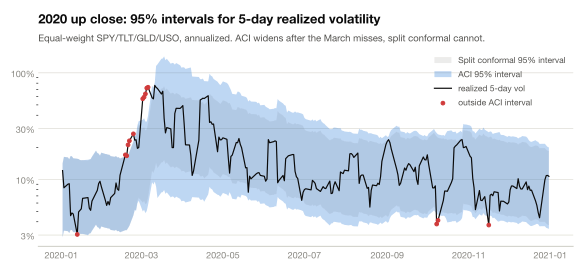
  </picture>
</p>

**A weather forecaster who says "70% chance of rain" is doing a good job if it rains on about 70% of those days.** That property is called *calibration*, and it is what we actually need from a risk model. Nobody can predict every market move; a useful model is one whose stated confidence can be trusted.

Most risk models are calibrated on calm data and then meet a crisis. In March 2020 this portfolio's volatility jumped from about 7% to 76% (annualized) in a few weeks. The most widely used model in the industry, which assumes returns follow a bell curve, ended up breaching its 99% loss limit on **twice as many days** as it promised. That isn't a rounding error. It is the difference between a risk limit that protects you and one that fails exactly when you need it.

The stakes depend on who you are:

| If you are… | …this is the problem Aegis addresses |
|---|---|
| **A risk manager or regulator** | Under the Basel rules, a bank whose 99% VaR model is breached too often is pushed from the *green zone* to *yellow* or *red*, raising its capital charge or forcing a model review. The adaptive model here stayed green on **98.8%** of days; the bell-curve model on **56.4%**. |
| **A portfolio manager** | Position sizes come from risk forecasts. Sizing on an *honest* risk estimate kept volatility close to its 10% target and gave the shallowest drawdown of every rule tested. |
| **An ML or data-science practitioner** | This is the general problem of **uncertainty under distribution shift**: a model calibrated on yesterday's data deployed into a world that changes. Markets are a hard, fully public test case, with a crash in the middle of the test set. |
| **A quant developer** | The whole study is reproducible from one command, guarded by 196 tests including leakage tests, and refreshed nightly by CI. Every number in this README comes from saved runs. |

> [!NOTE]
> **The core idea in one sentence.** The textbook method sets the error bar once, from past mistakes, and assumes the future looks like the past. The adaptive method (*Adaptive Conformal Inference*, ACI) keeps score as it goes: each time the range misses it widens a little, each time it holds it narrows a little. In 2020 that feedback loop is what kept the promise.

---

## What I built

<p align="center">
  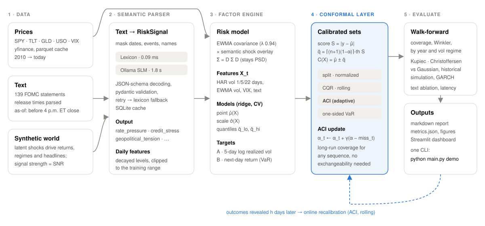
</p>

1. **Data.** Daily prices for an equal-weight portfolio of four funds a multi-asset desk would recognise: US stocks (SPY), long Treasuries (TLT), gold (GLD) and crude oil (USO), plus the VIX "fear index". Also every Federal Reserve (FOMC) statement since 2010, with its exact release time.
2. **A language reader.** A small language model, running locally, reads central-bank text and turns it into six numbers: are rates, inflation, growth, energy, geopolitical risk or credit stress rising or falling? A hand-written rule-based reader does the same as a fast, transparent baseline.
3. **A risk forecast.** A regression model predicts the portfolio's volatility over the next five days and its next-day Value at Risk (VaR).
4. **Error bars.** Conformal prediction turns each forecast into a range with a stated success rate, using only the forecast's own past errors. No assumption about the shape of returns.
5. **An honest test.** Fit on 2010–2017, set the error bars on 2018–2019, then walk forward through 2020–2026 one day at a time, learning each outcome only once it would really be known.

<p align="center">
  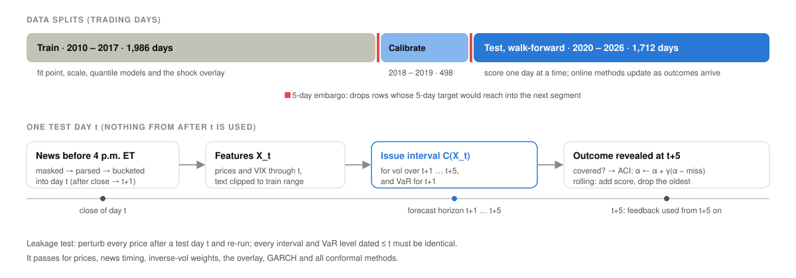
</p>

<details>
<summary><b>The math, for practitioners</b></summary>

<br>

**Point model.** A standardized ridge regression with a cross-validated penalty predicts the log realized portfolio volatility over the next 5 days from HAR terms (1, 5 and 22 days), EWMA volatilities (λ = 0.94), the VIX level and change, and optionally text features. A second target, next-day portfolio return, drives VaR and Expected Shortfall. The EWMA covariance can be rescaled by a text-driven shock overlay `Σ̃ = D Σ D`, which keeps it positive semi-definite and leaves correlations unchanged.

**Split conformal.** On the calibration set compute non-conformity scores and a finite-sample-corrected quantile:

$$S_i = \lvert y_i - \hat\mu(X_i) \rvert, \qquad \hat q = S_{(k)},\quad k = \lceil (n+1)(1-\alpha) \rceil, \qquad C(X) = [\hat\mu(X) - \hat q,\ \hat\mu(X) + \hat q]$$

If calibration and test data are exchangeable, $1-\alpha \le P(y \in C(X)) \le 1-\alpha + \tfrac{1}{n+1}$. Market data are not exchangeable.

**ACI** (Gibbs & Candès, 2021) updates its working level after every realized outcome, here with outcomes arriving 5 days late:

$$\alpha_{t+1} = \alpha_t + \gamma\,(\alpha - \mathrm{miss}_t), \qquad \Big\lvert \tfrac{1}{T}\textstyle\sum_t \mathrm{miss}_t - \alpha \Big\rvert \le \frac{\max(\alpha_1, 1-\alpha_1) + \gamma}{\gamma T}$$

The bound holds for *any* sequence. A floor of 0.2·α stops the working level from collapsing to an infinite interval after a cluster of misses. One-sided scores on returns give conformal VaR; the mean calibration score beyond the VaR cut-off gives conformal ES.

**Also implemented:** rolling-window conformal, DtACI (parameter-free ACI, Gibbs & Candès 2022), Mondrian (regime-conditional) conformal, normalized scores and conformalized quantile regression (CQR). Baselines: Gaussian EWMA (RiskMetrics), historical simulation, GARCH(1,1)-t, GJR-GARCH-t and filtered historical simulation (FHS).

</details>

---

## Results

All results are out-of-sample: 1,712 trading days from January 2020 to October 2026, never used for fitting or calibration.

### 1 · Error bars that keep their promise

<picture>
  <source media="(prefers-color-scheme: dark)" srcset="docs/assets/coverage-dark.svg">
  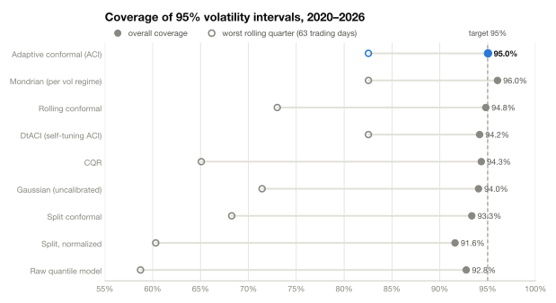
</picture>

The adaptive method (ACI) is the only one that hits 95% overall **and** has the best worst quarter (82.5%). The bell-curve interval looks close overall (94.0%), but swings from 89.7% in 2020 to 98% in 2024: right on average, wrong in every regime.

<picture>
  <source media="(prefers-color-scheme: dark)" srcset="docs/assets/by_year-dark.svg">
  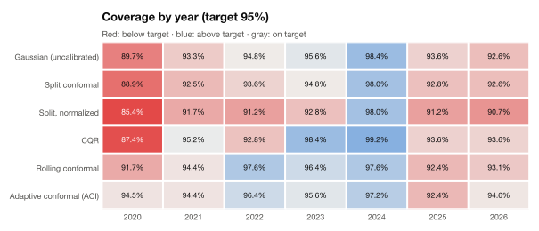
</picture>

It isn't tuned to one setting. Asked for 80%, 90%, 95% or 99%, ACI delivers 80.2%, 90.2%, 95.0% and 99.1%, while the textbook method falls 0.5–2.5 points short at every level. Across a 50× range of its one tuning knob, ACI's coverage stays between 94.9% and 95.1%.

### 2 · Loss limits a regulator would accept

**Value at Risk** is the loss a portfolio should not exceed on, say, 99 days out of 100. A *breach* is a day it did. Regulators count breaches; too many, and the model's capital charge rises or it is withdrawn.

<picture>
  <source media="(prefers-color-scheme: dark)" srcset="docs/assets/var-dark.svg">
  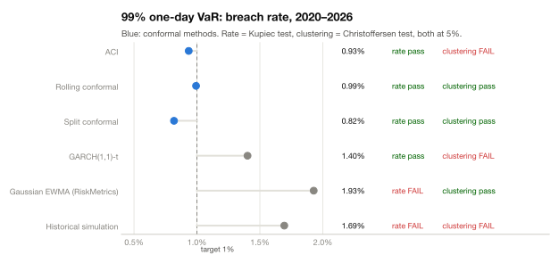
</picture>

<picture>
  <source media="(prefers-color-scheme: dark)" srcset="docs/assets/basel-dark.svg">
  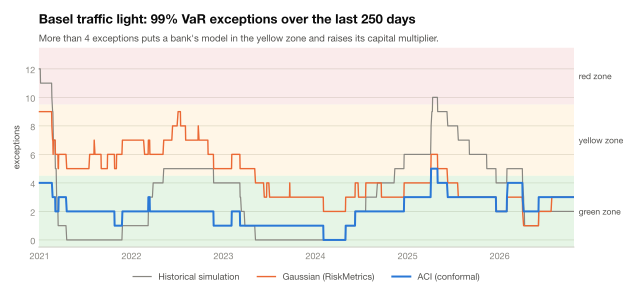
</picture>

Under the **Basel traffic light** (99% VaR breaches over the last 250 days: 0–4 green, 5–9 yellow, 10+ red), conformal models sat in the green zone on 94–99% of days, against 56% for the bell-curve RiskMetrics model. Historical simulation reached red.

> [!IMPORTANT]
> **The honest trade-off.** Being right costs capital. The adaptive model's wider limits implied average capital of 30.6% of the portfolio, against 18.0% for RiskMetrics. And the strongest classical model, **filtered historical simulation, was just as well calibrated with 19.3%**. Conformal's real advantage is that it needs no model of the return distribution, not that it wins every test.

<details>
<summary><b>Full VaR and Expected Shortfall backtests</b></summary>

<br>

| One-day VaR | 95%: breaches · Kupiec · Christoffersen | 99%: breaches · Kupiec · Christoffersen |
|---|---|---|
| Split conformal | 5.49% · pass · fail | 0.82% · pass · pass |
| Rolling conformal | 5.02% · pass · fail | 0.99% · pass · pass |
| ACI | 4.91% · pass · pass | 0.93% · pass · fail |
| DtACI | 4.61% · pass · fail | 1.05% · pass · fail |
| Gaussian EWMA (RiskMetrics) | 4.96% · pass · fail | 1.93% · fail · pass |
| Historical simulation (250 days) | 5.78% · pass · fail | 1.69% · fail · fail |
| GARCH(1,1)-t | 5.72% · pass · fail | 1.40% · pass · fail |
| GJR-GARCH-t | 5.78% · pass · fail | 1.34% · pass · fail |
| Filtered historical simulation (FHS) | 5.26% · pass · fail | 1.05% · pass · pass |

Kupiec tests whether the breach *rate* is right; Christoffersen tests whether breaches *cluster*. At 95% almost every method fails on clustering, since breaches arrive in bursts during crises. No single method passes everything; rolling conformal and FHS are cleanest at 99%, and ACI is the only method without clustered breaches at 95%.

| Method | ES 97.5% (Acerbi–Székely Z2) | 10-day 99% VaR breaches | Days in green zone | Max exceptions | Avg capital |
|---|---|---|---|---|---|
| Split conformal | -0.16 | 0.58% (pass) | 98% | 5 | 21.8% |
| Rolling conformal | -0.02 | 0.58% (pass) | 94% | 6 | 23.8% |
| **ACI** | +0.00 | 0.58% (pass) | 99% | 5 | 30.6% |
| DtACI | +0.04 | 0.58% (pass) | 96% | 6 | 26.3% |
| Gaussian EWMA (RiskMetrics) | -0.44 | 1.17% (pass) | 56% | 9 | 18.0% |
| Historical simulation | -0.54 | 3.51% (fail) | 66% | 12 | 18.7% |
| GARCH(1,1)-t | -0.26 | 0.58% (pass) | 77% | 8 | 18.1% |
| GJR-GARCH-t | -0.39 | 0.58% (pass) | 91% | 7 | 17.1% |
| **Filtered historical simulation** | -0.06 | 0.58% (pass) | 97% | 6 | 19.3% |

Z2 near 0 means Expected Shortfall (the average loss on the worst 2.5% of days) was right; negative means real tail losses were larger than forecast. 10-day breaches use non-overlapping windows. Capital is max(10-day VaR, multiplier × 60-day average) as a share of portfolio value.

</details>

### 3 · Better decisions with the same data

A risk forecast earns its keep when it changes a decision. The simplest decision is how much to hold. **Volatility targeting** holds less when the forecast says markets are rough and more when calm, aiming for a steady 10% a year (5 bp trading costs, max 2× leverage).

<picture>
  <source media="(prefers-color-scheme: dark)" srcset="docs/assets/strategies-dark.svg">
  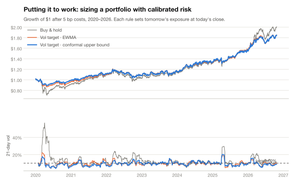
</picture>

| Strategy | Return | Volatility | Sharpe | Worst fall | Months too volatile | Days loss > 2% |
|---|---|---|---|---|---|---|
| Buy & hold (equal weight) | 10.8% | 14.3% | 0.75 | -30.2% | 35.4% | 1.81% |
| Vol target · EWMA forecast | 9.5% | 10.1% | 0.94 | -15.2% | 11.0% | 0.70% |
| Vol target · learned forecast | 10.0% | 10.3% | 0.97 | -15.3% | 12.8% | 0.47% |
| **Vol target · conformal upper bound** | 9.5% | 9.7% | **0.97** | **-13.6%** | **10.7%** | **0.35%** |
| Daily loss limit · conformal VaR | 10.2% | 11.8% | 0.87 | -16.6% | 33.2% | 0.82% |
| Daily loss limit · Gaussian VaR | 13.6% | 14.4% | 0.94 | -21.1% | 68.3% | 1.81% |
| Risk parity · vol target | 8.9% | 11.0% | 0.82 | -17.0% | 18.0% | 1.17% |

*Months too volatile*: share of 21-day windows where realized volatility ran above 1.25× the target.

- **Volatility targeting is the big win**: it halves the worst fall.
- **Sizing on the top of the conformal range adds a small but consistent edge**: the lowest volatility, the shallowest fall, the fewest overshoots. It is bought with a little return.
- **For loss limits, calibration decides compliance.** A 2% daily limit set with conformal VaR was broken on 0.82% of days (target 1%); set with bell-curve VaR, on 1.81%.
- **Where the risk comes from:** crude oil carried on average **57% of the portfolio's risk with 25% of its money**, which is also why risk parity, which shifts weight out of oil, did not help here.

---

## What didn't work

Reporting only the wins would make the wins less credible. The full list, with numbers, is in [chapter 10 of the guided study](https://priyanshu-mishra.github.io/aegis/#risk-factors) and the [validation report](docs/MODEL_CARD.md#7-limitations-and-known-weaknesses).

- **Reading the Fed did not improve the forecast.** Adding FOMC statements made the volatility forecast 1.2% worse with the rule-based reader and 2.8% worse with the language model. About eight statements a year is too sparse a signal next to the VIX, which prices the same news within minutes. The production setting is price-only.
- **A classical model matched the calibration more cheaply** (filtered historical simulation, above).
- **The adaptive model's tail breaches bunch together.** It learns from a miss only after it happens, so the first days of a shock still get through.
- **A neural network did not beat ridge, and a learned stress signal did not fix the clustering.** A small neural net had 6.5% higher forecast error than ridge (RMSE 0.456 vs 0.428, significant), and a logistic early-warning signal with AUC 0.62 left clustered 99% breaches unchanged (Christoffersen p 0.008). The conformal layer still held 94.6–95.3% coverage whichever model sat underneath. Details: [point models](docs/POINT_MODELS.md), [early warning](docs/EARLY_WARNING.md).
- **Fancier conformal scores lost to the simplest one.** Volatility-scaled scores and conformalized quantile regression never beat the plain absolute error (Winkler score 2.162 vs 2.277 and 2.301, lower is better): forecasting *log* volatility already makes errors similar in size in calm and stressed markets.
- **I found and fixed four bugs in my own pipeline**, each now guarded by a test: a schema that invited the language model to flip signs; an adaptive VaR that could go infinite after a run of misses; metrics that silently dropped those infinite days and flattered the breach rate; and a published algorithm (DtACI) that under-covered when outcomes arrive late.

---

## The language model: how it is used, and why it isn't fine-tuned

<picture>
  <source media="(prefers-color-scheme: dark)" srcset="docs/assets/slm-dark.svg">
  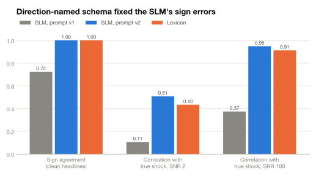
</picture>

The text layer uses **qwen2.5:3b**, a 3-billion-parameter open model, run locally through [Ollama](https://ollama.com). It is **not fine-tuned**: its weights are used exactly as published. Instead, its behaviour is shaped at inference time:

| Technique | What it does here |
|---|---|
| **Constrained decoding** | The model's output is forced to match a JSON schema (six shocks, sentiment, a volatility signal, per-asset impacts, evidence quotes), so it can't return free text. |
| **Schema design** | Every field is named after its *positive* direction (`credit_stress`, `geopolitical_tension`), so "spreads tightened" naturally maps to a negative number. |
| **Few-shot examples** | Four worked examples in the prompt, balanced on purpose: some where every pressure rises, some where every pressure falls. |
| **Determinism** | Temperature 0 and a fixed seed; answers are cached in SQLite by model, prompt version and text, which doubles as an audit log. |
| **Leakage control** | Dates, years, named events and people are masked before parsing, so the model can't recall what happened next. |
| **Validation and fallback** | Every answer is validated; an invalid one gets one retry with the error message, then falls back to the rule-based reader. |

**Why not fine-tune?** There are only 139 FOMC statements from 2010 to 2026, with no labelled "true shock" for any of them. Fine-tuning on market reactions instead would leave only 65 examples from the training years, which would overfit and risk teaching the model to memorise outcomes rather than read text. A synthetic world with *known* shocks answered the useful question instead: when the text does carry a signal, does the pipeline find it? It does, and forecast error falls steadily as the headlines get cleaner (from +1.9% with pure-noise headlines to −1.1% with near-noise-free ones).

**The schema bug.** The first schema used neutral names with a stated sign rule ("credit: positive = stress"). The model kept reversing it, agreeing with the true direction only 72% of the time on synthetic headlines. Renaming the fields and balancing the examples took that to **100%**, and its correlation with the true shock from 0.37 to 0.95, slightly ahead of the rule-based reader's 0.91. The trade-off is speed: about 1.8 seconds per text against 0.09 milliseconds.

<picture>
  <source media="(prefers-color-scheme: dark)" srcset="docs/assets/ablation-dark.svg">
  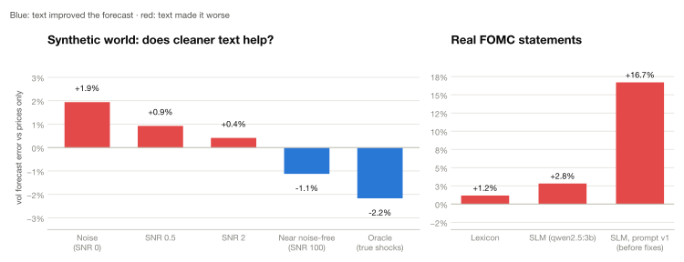
</picture>

---

## Engineering

**No look-ahead, by construction and by test.**
- A news item counts toward day *t* only if it was published before that day's 4 p.m. New York close.
- Each period ends with a 5-day embargo, so no target overlaps the next period.
- Adaptive methods see a 5-day-ahead outcome only once it has happened.
- GARCH parameters are fitted on training data only, then frozen.
- An end-to-end test perturbs every price after a day *t* and asserts that every interval and VaR level dated on or before *t* is unchanged.

**Statistical tests of the statistics.**
- Coverage is checked over 2,000 trials on deliberately misspecified models, against the finite-sample bound.
- ACI's long-run bound is checked exactly under a variance shift.
- The conformal quantile is property-tested (Hypothesis) against exact rational arithmetic.
- Kupiec, Christoffersen, ES, Z2, the Basel table and the capital formula are checked against hand calculations, numerical integration or simulation.

**Reproducible and self-checking.**
- Every chart in this README is regenerated from saved runs by `scripts/make_readme_assets.py`.
- The [validation report](docs/MODEL_CARD.md) is generated from the exported data; a test fails if it goes stale.
- The site's interactive charts re-implement conformal prediction and the rule-based reader in the browser; tests check them against Python to the last digit.
- Every weeknight, GitHub Actions refetches prices, reruns every backtest, rebuilds and deploys the site, then audits it with Lighthouse.
- Configs are typed and validated: a misspelled key, or an embargo shorter than the forecast horizon, fails loudly.

| Latency (Apple M4 Pro, `python main.py bench`) | |
|---|---|
| Full walk-forward backtest, 1,301 test days, all methods and baselines | 1.0 s |
| Score one day (forecast + conformal interval), median / 95th percentile | 0.39 / 0.56 ms |
| Rule-based text parse, median | 0.09 ms |
| Language-model text parse (qwen2.5:3b), median / 95th percentile | 1.8 / 1.9 s |

---

## What this project demonstrates

- **Thesis.** A risk forecast is only as useful as the claim it makes about its own error, and that claim must be audited, not assumed. Conformal prediction supplies a claim with a stated hit rate and no assumption about how returns are distributed.
- **Method.** Fit on 2010–2017, calibrate on 2018–2019, walk forward through 2020–2026 one day at a time, with each outcome revealed only when it would really be known. Everything is compared against five classical models.
- **Evidence.** Adaptive intervals held a 95% promise on 95.0% of unseen days (textbook: 93.3%) and 94.5% through 2020 (88.9%). A 99% loss limit was breached on 0.93% of days (RiskMetrics: 1.93%). Sizing on the forecasts halved the worst fall.
- **Candour.** Reading the Fed added nothing, a classical model matched the calibration for less capital, and tail breaches still cluster. All of it is reported.
- **Skills it shows.** Statistical method selection and validation, leakage-proof evaluation, regulatory-style backtesting, local-LLM integration with constrained decoding, test-driven research code, CI and a nightly-deployed public site.

Longer write-ups: [portfolio, CV and interview material](docs/PORTFOLIO.md) · [extending it with AI (two built, both negative)](docs/AI_EXTENSIONS.md) · [master's-scope research directions](docs/ROADMAP_ADVANCED.md)

---

## Quickstart

```bash
git clone https://github.com/priyanshu-mishra/aegis.git && cd aegis
```

```bash
python3 -m venv .venv && source .venv/bin/activate && pip install -e ".[dev,dashboard]"
```

```bash
python main.py demo
```

`demo` runs the whole pipeline offline on a synthetic market in about 3 seconds and writes a report to `reports/demo/`. Real data is one command away:

```bash
python main.py backtest -c configs/default.yaml
```

```bash
python main.py dashboard
```

<p align="center">
  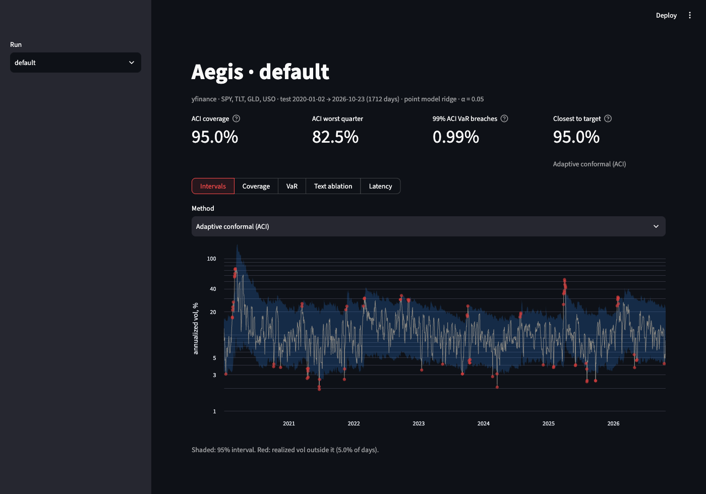
</p>

<details>
<summary><b>All commands</b></summary>

<br>

| Command | What it does |
|---|---|
| `demo` | Offline end-to-end run on a synthetic market (no network, no model) |
| `fetch -c configs/default.yaml` | Download and cache prices and FOMC statements |
| `backtest -c <config>` | Walk-forward backtest → series, `metrics.json`, figures and a markdown report in `reports/<name>/` |
| `report -c <config>` | Re-render the report from saved series |
| `ablation -c <config>` | Compare runs with and without text (plus SNR sweep and oracle on synthetic data) |
| `parse -c <config>` | Parse the news store and print signal statistics |
| `bench` | Latency benchmark → `reports/benchmark.json` |
| `sensitivity -c <config>` | Coverage and width across α, γ, rolling window and EWMA λ (`--quick` skips the λ re-runs) |
| `export-site -c <config>` | Export a saved run as JSON for the site (`site/public/data`; see `site/README.md`) |
| `model-card -c <config>` | Write the model validation report `docs/MODEL_CARD.md` from the exported site data |
| `dashboard` | Streamlit app over all saved runs |
| `config -c <config>` | Print the resolved configuration |

Any setting can be overridden from the command line, e.g. `--set conformal.alpha=0.1`. There are three configs: `default` (real data, price-only), `synthetic` (known-signal world) and `ollama` (real data plus the local language model).

</details>

<details>
<summary><b>Run the local language model</b></summary>

<br>

```bash
brew install ollama
```

```bash
ollama serve &
```

```bash
ollama pull qwen2.5:3b
```

```bash
python main.py ablation -c configs/ollama.yaml
```

</details>

<details>
<summary><b>Tests and lint</b></summary>

<br>

```bash
pytest
```

```bash
pytest -m "network or llm"
```

```bash
ruff check . && ruff format --check .
```

The default `pytest` run is fully offline. The `network` and `llm` markers add tests against yfinance, federalreserve.gov and a live Ollama model.

</details>

<details>
<summary><b>Repository layout</b></summary>

<br>

```
main.py                    CLI entry (same as the `aegis` command)
configs/                   default · synthetic · ollama
src/aegis/
  config.py                typed, validated YAML config with --set overrides
  data/                    prices (yfinance + cache) · news store (as-of) · FOMC loader · synthetic world
  slm_parser.py            RiskSignal schema · masking · lexicon + Ollama backends · SQLite cache
  features.py              HAR / EWMA / VIX features · targets · as-of signal aggregation · clipping
  risk_engine.py           EWMA covariance · shock overlay · point / scale / quantile models
  conformal_ncm.py         non-conformity scores · split / rolling / ACI / DtACI / Mondrian · runner
  baselines.py             Gaussian, historical sim., GARCH / GJR-GARCH and FHS VaR / ES
  risk_measures.py         Expected Shortfall · Acerbi–Székely Z2 · Basel traffic light · capital · Euler
  portfolio.py             vol targeting · VaR limits · risk parity (ERC) · costs · performance metrics
  sensitivity.py           coverage and width across α, γ, rolling window and EWMA λ
  model_card.py            model validation report (SR 11-7 shape) from the exported data
  metrics.py               coverage · Winkler · Kupiec · Christoffersen
  backtest.py              splits with embargo · walk-forward run for both targets
  report.py                metrics.json · figures · markdown report
  ablation.py · bench.py   text ablation · latency benchmark
dashboard/app.py           Streamlit dashboard over reports/*
site/                      the guided study (Astro + Svelte), its data contract and exported JSON
scripts/                   README charts · lexicon reference file · Lighthouse check · site status
docs/                      MODEL_CARD.md · PLAN.md and PLAN_v2.md (design + milestone log) · assets/
tests/                     196 offline tests + network and live-model tests
```

</details>

---

<p align="center">
  Built by <b>Priyanshu Mishra</b> ·
  <a href="https://github.com/priyanshu-mishra">GitHub</a> ·
  <a href="https://www.linkedin.com/in/priyanshu-mishra-/">LinkedIn</a> ·
  <a href="https://priyanshu-mishra.github.io/aegis/">Guided study</a>
  <br>
  <sub><a href="LICENSE">MIT</a> © 2026 · Research project, not investment advice.</sub>
</p>
